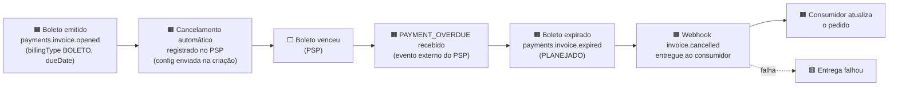
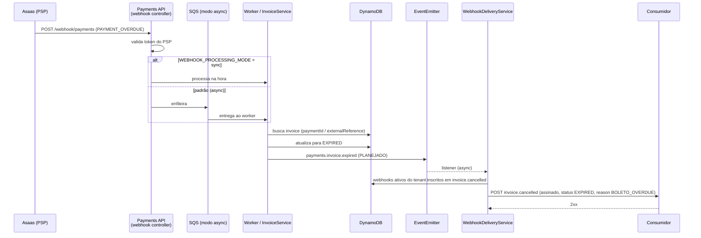
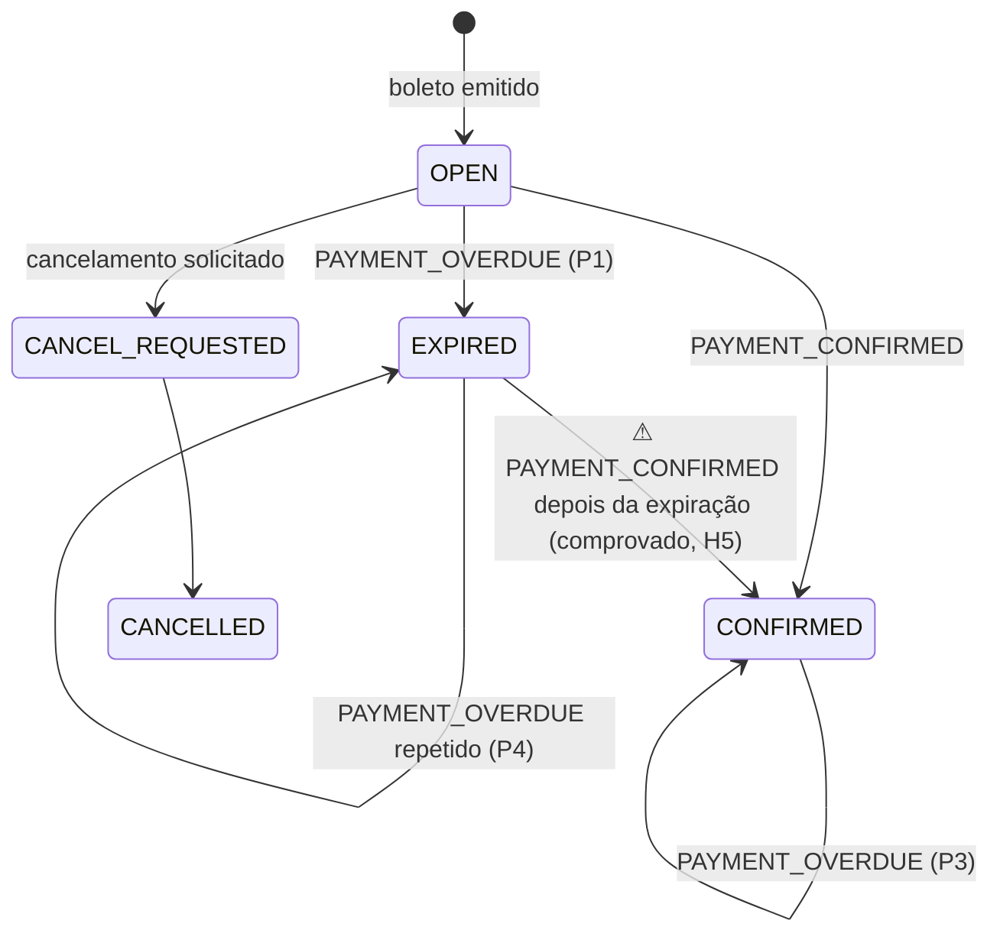

# Event Storming — Autocancelamento de boleto (proposta)

> **Status:** proposta para a sessão. Nada aqui altera código, testes ou o `plan.json`.
> **Dono do sinal e facilitador sugerido:** Christiano Milfont (Tech Lead que implementa)
> **Sinal:** [BS-006](../business-signals/BS-006.md) · **Intent:** [PI-017](../business-intents/PI-017.md) · **OBC:** [boleto-auto-cancellation](../obcs/boleto-auto-cancellation.md) · **BDD:** [boleto-auto-cancellation.feature](../bdd/boleto-auto-cancellation.feature) · **Catálogo:** [domain-events.md](../architecture/domain-events.md)
> H3, H5 e H6 foram **comprovados** em 2026-11-10 com um teste de investigação local (descartado depois; os fatos viraram os testes de `api/test/boleto-auto-cancellation.e2e-spec.ts`). Os demais **[verificar]** vêm só da leitura do código.

---

## 1. Objetivo e escopo

**Objetivo:** alinhar, antes de implementar, o que acontece desde o boleto emitido até o consumidor saber que ele foi cancelado por vencimento — e fechar a decisão do contrato do webhook.

| Dentro | Fora |
|---|---|
| Boleto emitido com cancelamento automático no PSP | Criação da invoice em si (já storm-ada no fluxo de criação) |
| Recebimento do `PAYMENT_OVERDUE` e expiração da invoice | PIX, cartão e Split Payment |
| Entrega do webhook de boleto cancelado ao consumidor | Cancelamento solicitado pela API (`cancel-invoice`), exceto onde compartilha o tipo externo |
| Observabilidade do fluxo | Conciliação financeira |

## 2. Participantes e formato sugeridos

| Quem | Por quê |
|---|---|
| Christiano Milfont | Dono do sinal e Tech Lead — decide o contrato |
| Representante do consumidor do webhook (Checkout / Order Management) | Confirma se aceita `invoice.cancelled` com `reason` — [apurar quem] |
| Quem opera o Asaas / Financeiro | Semântica do `PAYMENT_OVERDUE` e do cancelamento de registro — [apurar quem] |
| Plataforma / SRE | Entrega assíncrona, observabilidade, nova tentativa |

| Rodada | Duração | Saída |
|---|---|---|
| 1. Big Picture | 45–60 min | Linha do tempo de eventos de domínio e pontos críticos |
| 2. Processo | 45 min | Comandos, políticas, caminhos infelizes |
| 3. Design | 45 min | Agregados, contratos, payloads e rastreabilidade para OBC/BDD/teste |

## 3. Legenda

| Elemento | Cor | Significado neste doc |
|---|---|---|
| Evento de domínio | Laranja | Fato ocorrido, no passado |
| Comando | Azul | Intenção que causa um evento |
| Ator / sistema externo | Amarelo-claro | Quem ou o que dispara ou recebe |
| Política | Lilás | "Sempre que … então …" |
| Agregado | Amarelo | Quem garante a consistência |
| Read model | Verde | O que alguém consulta para decidir |
| Ponto crítico | Rosa | Dúvida, risco ou decisão em aberto |

## 4. Rodada 1 — Big Picture

### Atores e sistemas

| Ator | Papel |
|---|---|
| Pagador | Recebe o boleto; é passivo no fluxo |
| **Asaas (PSP)** | Registra o boleto, aplica o cancelamento automático e envia `PAYMENT_OVERDUE` |
| Tenant / consumidor | Mantém webhooks inscritos em `invoice.cancelled` e reage ao evento |
| Operação | Investiga entregas que falharam |
| Tempo | O vencimento + 1 dia dispara o fluxo (`daysAfterDueDateToRegistrationCancellation = 1`) |

### Linha do tempo de eventos



**Eventos de domínio do big picture**

| # | Evento | Situação hoje |
|---|---|---|
| 1 | Boleto emitido (`payments.invoice.opened`) | Emitido |
| 2 | Cancelamento automático configurado no PSP | Implementado (envia `daysAfterDueDateToRegistrationCancellation: 1`); sem evento próprio |
| 3 | `PAYMENT_OVERDUE` recebido do PSP | Recebido; o registro bruto é um evento planejado (`payments.webhook.received`) |
| 4 | Boleto expirado (`payments.invoice.expired`) | **Planejado — o código muda o status e não emite o evento** |
| 5 | Webhook `invoice.cancelled` entregue (`reason: BOLETO_OVERDUE`) | **Não existe — hoje a expiração não dispara webhook** |
| 6 | Entrega do webhook falhou | Existe como chave de observabilidade (`webhook.delivery.failed`), sem política de nova tentativa documentada |

## 5. Rodada 2 — Processo

### Comandos e políticas

| 🟦 Comando | Quem emite | Resulta em |
|---|---|---|
| Criar invoice de boleto (com a configuração de cancelamento) | Consumidor → API | `payments.invoice.opened` |
| **Expirar boleto** | Política P1 | `payments.invoice.expired` |
| Entregar webhook | Política P2 | Entrega ao consumidor |

| 🟪 Política | Regra |
|---|---|
| **P1** | Sempre que chegar `PAYMENT_OVERDUE` para invoice `BOLETO` ainda não paga → expirar a invoice |
| **P2** | Sempre que uma invoice expirar → entregar `invoice.cancelled` aos webhooks ativos do tenant inscritos nesse tipo |
| **P3** | Sempre que chegar `PAYMENT_OVERDUE` para invoice `CONFIRMED` → ignorar (pagamento prevalece) |
| **P4** | Sempre que chegar `PAYMENT_OVERDUE` repetido para invoice já `EXPIRED` → ignorar, sem novo evento nem webhook |
| **P5** | Sempre que chegar `PAYMENT_OVERDUE` para invoice que não é `BOLETO` → ignorar e registrar |

### Sequência (caminho feliz)



### Estados da invoice (subconjunto relevante)



### Caminhos infelizes

| Cenário | Comportamento atual | Comportamento desejado | BDD |
|---|---|---|---|
| Invoice já `CONFIRMED` | Retorna sem alterar nada (sem registro) | Igual, e sem evento nem webhook | "Boleto confirmado não é expirado" |
| Invoice já `EXPIRED` | Retorna sem alterar nada (sem registro) | Igual, sem evento nem webhook duplicados | "Webhook duplicado é idempotente" |
| `billingType` ≠ `BOLETO` | Ignora e registra (`recordIgnoredProviderEvent`) | Igual | "billingType incorreto é ignorado" |
| Invoice não encontrada | Registra como não correlacionado | Igual | — (fora do BDD atual) |
| Token do PSP inválido | Rejeita (401) e registra | Igual | — |
| Endpoint do consumidor falha | Não há política documentada | A expiração **não** é desfeita; falha registrada | "Falha na entrega não desfaz a expiração" |
| Consumidor não inscrito | — | Nenhuma entrega | "Consumidor não inscrito não recebe" |

## 6. Rodada 3 — Design

### Agregados e invariantes

| 🟨 Agregado | Invariante |
|---|---|
| **Invoice** | `EXPIRED` só vem de `OPEN`/pendente, nunca de `CONFIRMED`; a expiração acontece uma vez |
| **Assinatura de webhook** (por tenant) | Só entrega para webhooks ativos que incluem o tipo (`events.includes`) |
| **Entrega** | Identificada por `X-Payments-Delivery-Id` e assinada com HMAC |

### Eventos — proposta de contrato

| Camada | Nome | Payload | Situação |
|---|---|---|---|
| Domínio (interno) | `payments.invoice.expired` | `invoiceId`, `orderId`, `tenantId`, `provider`, `providerPaymentId`, `billingType`, `dueDate`, `expiredAt`, `correlationId` | Planejado |
| Externo (webhook) | `invoice.cancelled` | `invoiceId`, `orderId`, `amount`, `currency`, `status: EXPIRED`, `reason: BOLETO_OVERDUE`, `billingType`, `dueDate`, `cancelledAt` | Planejado — **a confirmar com o consumidor** |
| Observabilidade | `pagamento.expiracao.cobranca.boleto.expirada` | dimensões do evento de observabilidade existentes | Proposta |
| Observabilidade | `pagamento.expiracao.cobranca.expiracao.ignorada` | `reason`: `confirmado` / `ja_expirado` / `billing_type` | Proposta |

> As chaves `pagamento.*` seguem o estilo do `plan.json` e são a **camada de observabilidade**, não eventos de domínio (ver `domain-events.md`, seção 1). Os nomes acima são sugestões para validar.

### Read models

| 🟩 Read model | Quem usa | Como |
|---|---|---|
| Status da invoice | Consumidor, suporte | `GET /invoices/:id` (retorna `EXPIRED`) |
| Entregas de webhook | Operação | Hoje só por log e métrica `webhook.delivery.*` — sem consulta dedicada |

## 7. Pontos críticos (hot spots)

| # | 🟥 Ponto crítico | Por que importa | Pergunta para a sessão | Quem decide |
|---|---|---|---|---|
| H1 | **`invoice.cancelled` ou tipo novo `invoice.expired`?** | O consumidor pode tratar o vencimento como cancelamento pedido por ele (RISK-BC-003) | O consumidor aceita `status: EXPIRED` + `reason`? | Christiano + consumidor |
| H2 | **Quando o Asaas envia `PAYMENT_OVERDUE` em relação ao cancelamento do registro?** | Define quando a invoice expira e se ainda dá para pagar entre os dois | Qual a semântica exata com `daysAfterDueDate... = 1`, e o fuso do vencimento? | Quem opera o Asaas |
| H3 | **Entrega assíncrona dentro de Lambda** | **Comprovado:** o listener é `{ async: true }` e a entrega não é aguardada. Com consumidor de 400 ms, o `POST /webhook/payments` respondeu em ~30 ms com 0 entregas concluídas (a requisição ao consumidor só tinha começado). O worker SQS retorna no mesmo ponto; se o Lambda congelar, a entrega pode se perder (o congelamento não foi simulado) | Aguardar a entrega antes de responder, ou entregar por fila própria? | Christiano + SRE |
| H4 | **Processamento assíncrono por padrão** | Só `WEBHOOK_PROCESSING_MODE=sync` processa na hora; o padrão enfileira. A expiração e o webhook ocorrem depois da resposta ao PSP | Qual o atraso aceitável entre o `OVERDUE` e o webhook ao consumidor? (SLI do OBC está em `[apurar]`) | Consumidor + SRE |
| H5 | **Pagamento confirmado depois da expiração** | **Comprovado:** `PAYMENT_OVERDUE` → `EXPIRED`; depois `PAYMENT_CONFIRMED` → 200, invoice vira `CONFIRMED` e emite `payments.invoice.confirmed`. Com o autocancelamento, o consumidor receberia `invoice.cancelled` e depois `invoice.confirmed` para o mesmo pedido | Confirmar após expirar é permitido (pagamento tardio) ou deve ser rejeitado? O contrato do webhook precisa cobrir a sequência (liga ao RISK-BC-001) | Christiano + Financeiro + consumidor |
| H6 | **Nova tentativa de entrega** | **Confirmado no código:** `WebhookDeliveryService.deliver` faz uma única tentativa (timeout de 10 s) e só emite `webhook.delivery.failed`; não há retry nem DLQ. Uma falha pontual perde a notificação | Quantas tentativas, em que intervalo, e o que fazer com a DLQ? | SRE |
| H7 | **Casos silenciosos** | `CONFIRMED` e `EXPIRED` retornam sem registrar nada: não aparecem em nenhum painel | Registrar os "ignorados" em observabilidade? | Christiano |
| H8 | **Mais de um webhook por tenant** | Cada webhook inscrito recebe a entrega: o consumidor pode receber duplicado se registrar dois endpoints | Existe esse caso? Como deduplicar (`X-Payments-Delivery-Id`)? | Consumidor |
| H9 | **Ordem: persistir antes de emitir** | Se o evento for emitido antes do `updateInvoice` falhar, o consumidor sabe de algo que não aconteceu | O evento só sai depois de persistir? (hoje o `updateInvoice` precede) | Christiano |
| H10 | **Payload do cancelamento solicitado sem `reason`** | `invoice.cancelled` passaria a ter `status` `CANCELLED` ou `EXPIRED`; o solicitado não traz `reason` | Padronizar `reason` também no cancelamento solicitado? | Christiano + consumidor |

## 8. Observabilidade e SLIs propostos

| Pergunta que o painel responde | Métrica / evento | Meta |
|---|---|---|
| Quantos boletos expiraram? | contagem de `pagamento.expiracao.cobranca.boleto.expirada` | — |
| Quanto demora do `PAYMENT_OVERDUE` ao webhook? | latência recebido → entregue | [apurar] |
| A entrega funciona? | taxa de `webhook.delivery.sent` vs `.failed` para `invoice.cancelled` | [apurar] |
| Há expirações ignoradas? | contagem de `…expiracao.ignorada` por `reason` | — |
| A invoice expirada foi paga depois? (H5) | contagem de confirmações em invoice `EXPIRED` | 0 |

**Rascunho de entradas para o `plan.json`** (não aplicado — seguiria o formato de `customEvents`):

```json
{
  "title": "pagamento.expiracao.cobranca.boleto.expirada",
  "text": "Boleto vencido expirado automaticamente — webhook invoice.cancelled disparado",
  "tags": ["event_key:pagamento.expiracao.cobranca.boleto.expirada", "env:dev", "stage:boleto_expirado",
           "actor:system", "service:pagamento", "touch_point:expiracao_boleto",
           "business_domain:pagamento", "source:odd"],
  "alert_type": "success", "priority": "normal",
  "source_type_name": "odd-business-event", "aggregation_key": "boleto_expirado"
}
```

## 9. Rastreabilidade: do evento ao teste

| Elemento | OBC | BDD | Teste e2e (a escrever) | Código a alterar |
|---|---|---|---|---|
| P1 + evento `payments.invoice.expired` | Regras 1–2, Observable Events | "Boleto vencido é automaticamente expirado" | Espera o evento emitido | `expireBoletoInvoice` emite via `PaymentsEvent` |
| P2 + webhook `invoice.cancelled` | Regra 5 | "…entrega o webhook … ao consumidor inscrito" | Servidor falso do consumidor recebe o webhook assinado com `status`/`reason` (**escrito e passando**) | `WebhookDeliveryService` escuta `payments.invoice.expired` (**feito**) |
| Consumidor não inscrito | Regra 5 | "…não inscrito … não recebe" | Nenhuma entrega | filtro `events.includes` (já existe) |
| Falha de entrega (H3, H6) | Regra 7 | "Falha na entrega … não desfaz a expiração" | Endpoint 500 → invoice segue `EXPIRED` | tratamento de erro da entrega |
| P4 | Regra 2 | "Webhook duplicado é idempotente" | Segundo `OVERDUE` sem nova entrega | já idempotente; o teste precisa checar o webhook |
| P3 | Regra 3 | "Boleto confirmado não é expirado" | Sem evento e sem webhook | já protegido |
| P5 | Regra 1 | "billingType incorreto é ignorado" | Sem evento e sem webhook | já protegido |
| Config no PSP | Configuração | "…criado com configuração…" / "valor padrão" | já coberto | — |

## 10. Ordem sugerida de implementação (TDD)

1. ✅ Escrever os testes e2e da tabela acima, vendo-os falhar.
2. ✅ Emitir `payments.invoice.expired` em `expireBoletoInvoice`.
3. ✅ Fazer o `WebhookDeliveryService` escutar o evento e mapear para `invoice.cancelled`.
4. ✅ Tratar H3 (aguardar a entrega) e H9 (emitir após persistir); H6 fica como evolução.
5. ✅ Atualizar OBC (`Planejado` → `Emitido`), catálogo e Service Decks. Falta promover o OBC (Owner) e commitar.

## 11. Decisões

Tomadas em 2026-11-10 pelo dono do sinal (Christiano Milfont), seguindo as boas práticas abaixo. Registradas no OBC (seção Decisões).

| # | Decisão | Boa prática aplicada | Pendente de confirmação |
|---|---|---|---|
| H1 | Reutilizar `invoice.cancelled`, com `status: EXPIRED` e `reason: BOLETO_OVERDUE` | Mudança aditiva e compatível; não obriga o consumidor a se reinscrever | Consumidor aceita? (RISK-BC-003) |
| H3 | Aguardar a entrega (`emitAsync`, listener sem `async: true`); falha na entrega não desfaz a expiração | Não confiar em trabalho em segundo plano dentro de Lambda | Aceitar que o processamento dure até 10 s no pior caso |
| H5 | Manter a aceitação de pagamento depois da expiração | Nunca descartar dinheiro recebido; tornar a sequência explícita no contrato | Financeiro e consumidor (RISK-BC-001) |
| H6 | Sem retry/DLQ nesta entrega; evolução para todos os webhooks | Escopo pequeno; o problema não é específico deste evento | Planejar como item próprio |
| H4, H2 | Abertas | — | Atraso aceitável (SLI) e semântica do `PAYMENT_OVERDUE` no Asaas |
| H10 | Aberta | — | `reason` também no cancelamento solicitado |

**Implementado (sem commit):** `payments.invoice.expired` emitido em `expireBoletoInvoice` depois de persistir; entrega `invoice.cancelled` pelo `WebhookDeliveryService`; 14 testes e2e em `api/test/boleto-auto-cancellation.e2e-spec.ts`; suíte completa 103/103 (rodada em série).
